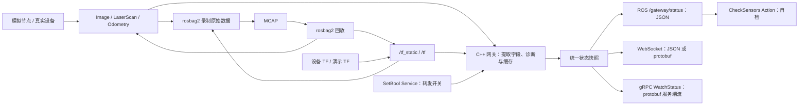

# ROS 2 多传感器通信网关

一套 C++17 编写的机器人状态网关。它订阅相机图像、激光雷达和里程计，汇总传感器状态，
通过 ROS Topic、WebSocket 和 gRPC 对外发布。开发者可以用模拟数据演示完整链路，
也可以录制原始消息和 TF，在独立 ROS Domain 中回放问题场景。

- **环境**　Ubuntu 24.04 · ROS 2 Jazzy · CycloneDDS
- **技术栈**　C++17 · rclcpp · tf2 · OpenCV · Boost.Beast · Protobuf · gRPC · rosbag2 · CMake

## 从传感器到客户端



默认模拟节点以 **10 Hz** 产生三路输入，网关以 **5 Hz** 发布状态。每次快照包含进程内发布序号、
三路接收计数、数据新鲜度和诊断信息。网络客户端订阅的是状态摘要，原始数据由 rosbag2 保存。

## 已实现功能

| 模块 | 实现 |
| --- | --- |
| 传感器接入 | 订阅 `Image`、`LaserScan`、`Odometry`。Launch 可切换模拟源和已有 ROS Topic，并配置输入 QoS。 |
| 状态与坐标 | 汇总图像元信息、雷达有效点和最近点、里程计位姿与速度。按扫描时间戳将雷达最近点转换到目标坐标系。可选 OpenCV 图像质量诊断覆盖亮度、对比度和清晰度。 |
| ROS 接口 | `/gateway/status` 发布状态，`/gateway/set_enabled` 控制业务数据转发。独立的 `/gateway/check_sensors` Action 支持 1–60 秒观察、进度反馈、取消和结果报告。 |
| 并发与诊断 | 三线程 `MultiThreadedExecutor` 调度传感器、控制和默认回调组。诊断区分端点缺失、消息类型错误、QoS 不兼容和数据过期。 |
| 网络转发 | WebSocket 支持多客户端，启动时选择 JSON 或 protobuf。gRPC `WatchStatus` 发送当前快照和后续更新，慢客户端允许跳过中间快照。 |
| 录制与回放 | 用 rosbag2 将原始消息及可选静态、动态 TF 写入 MCAP。回放支持 `/clock`、循环和时间回跳，网络客户端可复用同一接口。 |

## 开发中的难点与解决方案

| 遇到的问题 | 解决方案与验证 |
| --- | --- |
| **发现了发布者，却收不到传感器数据** | DDS 发现和数据匹配分别检查。对同类型端点的实际 QoS 执行兼容性检查，并记录不兼容事件、接收频率和新鲜度。集成测试用 Reliable 订阅配 Best Effort 发布，复现真实不匹配，再验证兼容端点接入后恢复。 |
| **TF 晚到，直接用最新变换可能得到错误坐标** | 用雷达原始采样时间戳查询历史 TF，默认立即返回。需要等待时用有界队列和定时器重试，避免阻塞订阅回调。录制时以 `transient_local` QoS 收取早于录制启动的 `/tf_static`。测试覆盖晚到、超时和隔离回放的坐标数值。 |
| **并发输入、转发开关和多个客户端需要读到一致的状态** | 传感器和控制回调分组调度，在同一临界区复制缓存与转发开关。编码和写网络在锁外执行，WebSocket 二进制和 gRPC 复用同一份 protobuf 状态。并发测试按 100 Hz 配置输入和发布，连续切换开关 60 次。协议测试按同一发布序号逐字段比较 ROS、WebSocket、gRPC。 |
| **暂停或循环回放时，ROS 时钟会停住或回跳** | 用单调时钟计算新鲜度和自检超时，用 ROS 时间标记状态，用消息时间查询 TF。时钟回跳时清理旧摘要和待处理扫描，用时间代号区分两段回放。测试覆盖暂停后的过期、自检中止和循环后恢复。 |

完整设计见 [执行与并发](docs/gateway.md)、[QoS 诊断](docs/diagnostics.md)、[动态 TF 与回放时间](docs/replay_time.md) 和 [状态协议](docs/protocol.md)。

## 快速演示

### 1. 构建

需要 Ubuntu 24.04、ROS 2 Jazzy、colcon 和已初始化的 rosdep。依赖由 `package.xml` 声明，
包括 gRPC 开发库、protoc 插件和 Python 客户端运行库。

```bash
git clone https://github.com/JackieesLiao/ros_gateserver.git
cd ros_gateserver
source /opt/ros/jazzy/setup.bash
rosdep install --from-paths src --ignore-src --rosdistro jazzy -y
colcon build --packages-up-to ros_gateserver --cmake-args -DCMAKE_BUILD_TYPE=Release
```

演示涉及的每个终端都从仓库根目录加载环境：

```bash
source /opt/ros/jazzy/setup.bash
source install/setup.bash
export RMW_IMPLEMENTATION=rmw_cyclonedds_cpp
```

### 2. 启动模拟数据和网关

在终端 A 启动模拟源、静态 TF、自检 Action 和两种网络输出：

```bash
ros2 launch ros_gateserver mvp.launch.py \
  demo_tf:=true self_check:=true ws_format:=protobuf grpc_enabled:=true
```

在终端 B 查看三路输出，并发起一次自检：

```bash
ros2 topic echo /gateway/status --once
ros2 run ros_gateserver protobuf_client --count 1
ros2 run ros_gateserver grpc_client --count 3
ros2 action send_goal /gateway/check_sensors \
  ros_gateserver_interfaces/action/CheckSensors \
  '{duration_sec: 3.0, require_scan_tf: true}' --feedback
```

状态的 `sensors.scan.data.nearest_point` 显示转换后的雷达最近点，自检结果的 `passed` 表示检查是否通过。
把启动命令的 `ws_format` 改成 `json`，也可以用浏览器连接 `ws://127.0.0.1:8765` 查看文本状态。
gRPC 启用后默认监听 `127.0.0.1:50051`，使用明文连接。

### 3. 录制并回放同一条链路

在终端 B 录制原始 ROS 消息和静态 TF：

```bash
ros2 run ros_gateserver record_bag --output bags/showcase --duration 8 --with-static-tf
ros2 bag info bags/showcase
```

在终端 A 按 Ctrl+C 停止实时模拟源与网关，再启动回放：

```bash
ros2 launch ros_gateserver replay.launch.py \
  bag_path:=bags/showcase use_sim_time:=true ws_format:=protobuf grpc_enabled:=true
```

再次运行 gRPC 或 WebSocket 客户端即可观察回放状态。播放结束后，网关继续运行，
可以观察各路数据的 `fresh` 超时变为 `false`。更多配置见 [演示与配置手册](docs/demo.md) 和 [录放实现](docs/recording.md)。

## 测试与验证范围

在 **ROS 2 Jazzy + CycloneDDS** 环境下，两个 ROS 包构建成功，**10 个集成测试通过**。
测试使用模拟或受控 ROS 发布者、独立 ROS Domain 和临时端口。

| 测试 | 验证内容 |
| --- | --- |
| `smoke_test.py`、`concurrency_test.py`、`action_test.py` | 启动与退出、转发开关、多线程状态一致性、自检反馈和取消 |
| `protobuf_test.py`、`grpc_test.py` | 字段与缺失值语义、三路输出一致性、并行订阅、流取消、端口冲突 |
| `tf_test.py`、`time_tf_test.py`、`rosbag_test.py` | 坐标数值、静态与动态 TF、MCAP 原始数据、历史变换、时钟暂停和回跳 |
| `qos_test.py`、`image_quality_test.py` | DDS 不兼容与恢复、图像质量指标、坏帧恢复、回放重算 |

```bash
(
    set -e
    for suite in smoke concurrency action protobuf grpc tf time_tf rosbag qos image_quality; do
        python3 "tests/${suite}_test.py"
    done
)
```

验证范围为本机模拟、受控输入和录放链路。真实硬件负载、云端部署和 ROS 2 Humble 兼容性尚未验证。

## 代码入口

- ROS 接入、状态快照和转发开关。[网关节点](src/ros_gateserver/src/gateway.cpp)
- 自检观察、反馈、取消和结果报告。[自检节点](src/ros_gateserver/src/sensor_check_server.cpp)
- protobuf 消息与 gRPC 服务定义。[状态协议](src/ros_gateserver/proto/gateway_status.proto)
- 最新快照订阅和退出收尾。[gRPC 服务](src/ros_gateserver/src/grpc_status_server.cpp)
- 独立回放、TF 与模拟时钟配置。[回放入口](src/ros_gateserver/launch/replay.launch.py)
