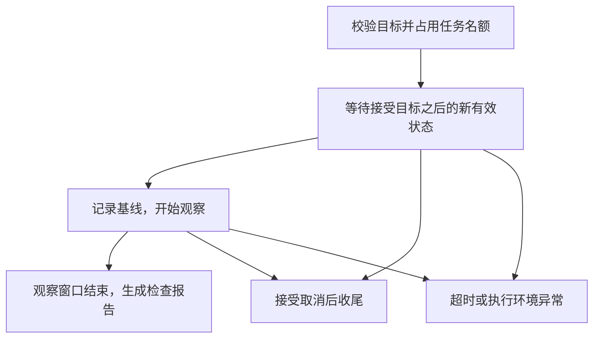

# 传感器自检 Action

自检是一个独立任务节点，检查网关在指定观察窗口内报告的三路传感器健康情况。
它不控制机器人运动，不启动录制，也不修改网关的转发开关。

## 文件与职责

| 文件 | 职责 |
| --- | --- |
| `src/ros_gateserver_interfaces/action/CheckSensors.action` | Goal、Result、Feedback 类型 |
| `src/ros_gateserver/src/sensor_check_server.cpp` | 非阻塞任务状态机 |
| `tests/action_test.py` | 拒绝、反馈、取消、报告、失联、计数倒退与退出 |
| `tests/protobuf_test.py` | 真实网关在 protobuf 模式下执行自检 |

接口包与实现包分开，C++ 和 Python 客户端可以使用同一份生成类型。

## 启动与调用

各终端在工作区根目录加载环境：

```bash
source /opt/ros/jazzy/setup.bash
source install/setup.bash
export RMW_IMPLEMENTATION=rmw_cyclonedds_cpp
```

启动完整演示，自检节点默认不启动，需显式打开：

```bash
ros2 launch ros_gateserver mvp.launch.py demo_tf:=true self_check:=true
```

发送目标：

```bash
ros2 action send_goal /gateway/check_sensors \
    ros_gateserver_interfaces/action/CheckSensors \
    '{duration_sec: 10.0, require_scan_tf: true}' --feedback
```

也可以独立启动任务节点，配置输入 Topic 和超时：

```bash
ros2 run ros_gateserver sensor_check_server --ros-args \
    -p status_topic:=/gateway/status \
    -p startup_timeout_sec:=5.0 \
    -p status_timeout_sec:=1.0
```

取消由 Action 客户端的取消接口发起。Python 示例，`handle` 为已接受的目标句柄：

```python
cancel_future = handle.cancel_goal_async()
result_future = handle.get_result_async()
```

客户端仍需运行执行器并等待结果，最终状态为 `CANCELED` 才表示执行侧已完成取消。
关闭客户端不等同于发出取消请求。

## 接口约定

Goal 中 `duration_sec` 必须有限且位于 1～60 秒；`require_scan_tf` 决定是否检查雷达转换状态。
一次只允许一个活动目标，繁忙或参数非法时拒绝新目标。

Feedback 包含：

- `phase`：`WAITING_FOR_GATEWAY` 或 `OBSERVING`。
- `progress`：观察阶段的进度，范围 0～1。
- `unhealthy_sensors`：最新状态中缺失或过期的传感器。
- `failed_checks`：本次观察到的累计失败项。

Result 包含 `passed`、实际观察时间 `observed_sec`、结果消息和累计失败项。
观察过程中出现过的异常会保留，即使随后恢复；结束时还要求每路接收计数至少增长一次。

| 场景 | Action 终态 | 结果 |
| --- | --- | --- |
| 检查完成且全部通过 | `SUCCEEDED` | `passed=true` |
| 检查完成但发现异常 | `SUCCEEDED` | `passed=false`，列出失败项 |
| 等待网关超时 | `ABORTED` | `gateway_startup_timeout` |
| 观察期间有效心跳丢失 | `ABORTED` | `gateway_status_timeout` |
| 观察期间计数倒退 | `ABORTED` | `sensor_counter_regressed` |
| 观察期间网关时间线改变 | `ABORTED` | `gateway_clock_changed` |
| 接受取消并完成收尾 | `CANCELED` | `canceled`，保留部分观察信息 |

传感器失败项包括 `image_missing`、`image_stale`、`image_not_updated` 等，
雷达和里程计分别使用 `scan`、`odom` 前缀。
要求 TF 时，转换失败记录 `scan_tf_unavailable`；转发关闭导致详情被隐藏时，
记录 `scan_tf_not_observable`，不将其解释成雷达硬件故障。
未要求 TF 时，转发关闭不会阻止基于计数和新鲜度的检查。

## 状态机与并发



`handleGoal()` 立即接受或拒绝；`handleAccepted()` 只创建任务上下文。
100 ms 定时器推进任务，反馈间隔至少 500 ms，不使用阻塞循环或 detached 工作线程。
所有回调位于默认互斥组，任务状态串行访问。

等待网关时间与实际观察时间分开，并使用本机 steady_clock 计时。
模拟时间暂停不会暂停观察窗口；时间回跳或时间源切换使当前观察中止，需要重新提交目标。
节点接受没有 clock 字段的旧摘要；新摘要使用 clock.epoch 检测时间线改变。
每个目标必须等待接受之后的新状态，避免复用上一任务的旧基线。
取消回调只决定是否接受；定时器先检查 `is_canceling()`，再调用 `canceled()`。
终态统一在 `finish()` 中收尾，清除任务占用，不再发送反馈或第二份结果。

## ROS 2 机制与代码入口

`CheckSensors.action` 的三段定义由 rosidl 生成 C++ 和 Python 类型。
`rclcpp_action::create_server()` 注册目标、取消和接受后的三个回调。
ROS 2 Action 在通信层组合发送目标、获取结果、取消目标三个服务，以及反馈和状态两个 Topic；
应用通过 Goal UUID 区分任务，`ServerGoalHandle` 负责对应目标的状态转换。
任务执行逻辑由本项目的定时器推进，Action 接口本身不会替业务自动执行检查。

| 函数 | 数据如何流动 |
| --- | --- |
| `handleGoal()` | 校验时长与繁忙状态，预留唯一任务名额 |
| `handleAccepted()` | 保存目标句柄，进入等待阶段 |
| `onStatus()` / `parseStatus()` | 校验 ROS JSON，记录本机接收时间和各路计数 |
| `startObservation()` | 收到新状态后记录观察起点与计数基线 |
| `checkSensors()` | 累计缺失、过期和可选 TF 失败项 |
| `tick()` | 按取消、执行故障、正常完成的顺序决定是否结束 |
| `publishFeedback()` | 从任务上下文生成阶段、进度和失败项 |
| `finish()` | 移出活动任务，发送唯一终态与结果 |

真实数据路径为传感器 Topic → Gateway 摘要 → `/gateway/status` → 自检订阅 →
任务上下文 → 反馈与结果。自检只读取摘要，不复制原始图像、雷达数组或 Gateway 内存。

## 可观测性边界

节点订阅网关的周期摘要，不能证明每条原始消息都正确，也不提供精确采集频率测量。
当前自检检查计数、新鲜度和可选 TF，不读取图像 quality；质量提示不会自动改变 passed。
它按本机接收时间检查网关心跳；无效 JSON 或不支持的 schema 不刷新心跳。
网关停止后，即使最后一份摘要仍写着 `fresh=true`，任务也会因本地心跳超时结束。

计数倒退会使当前观察无效；没有网关实例标识时，不能保证识别所有重启情况。
节点退出时释放任务资源，但进程崩溃或 ROS 上下文关闭后不保证结果能送达，
客户端必须自行设置等待超时。任务和结果没有跨进程重启持久化。
观察期间反馈和取消的处理受执行器调度影响，不提供硬实时截止保证。
