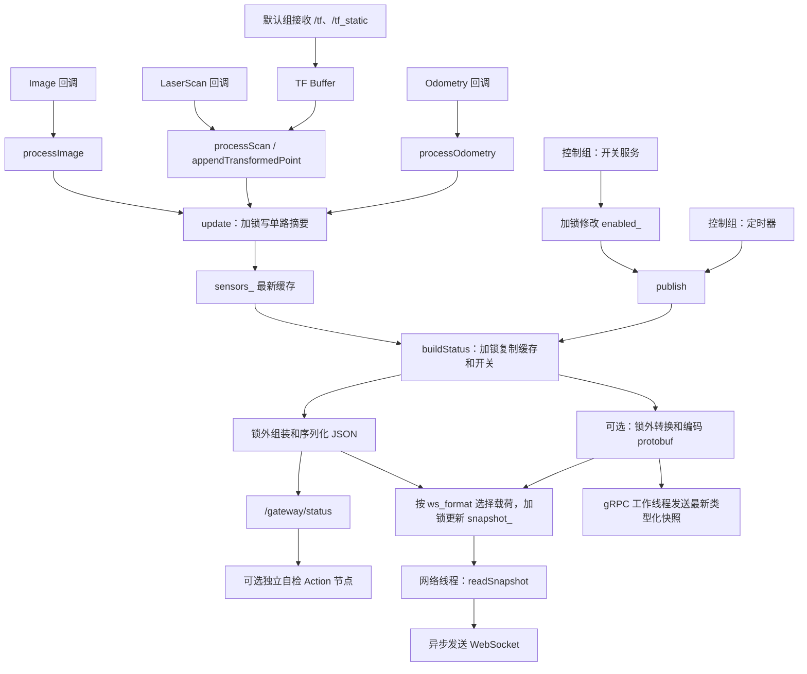

# Gateway 的执行顺序、数据流与并发边界

当前实现采用 C++17、rclcpp、tf2、三个线程的 MultiThreadedExecutor，
以及一个运行 Boost.Asio 的独立 WebSocket 线程。开启 gRPC 时由 gRPC 工作线程处理订阅流。
执行器负责调度 ROS 回调，回调组规定哪些回调可以重叠执行。

## 从哪里开始阅读

`src/ros_gateserver/src/gateway.cpp` 的 `main()` 先构造 Gateway，再将节点加入多线程执行器。
构造函数初始化 TF、回调组和缓存，注册 ROS 接口后启动可选的 gRPC 服务，发布初始快照，再启动 WebSocket。
首个快照可用后，已连接的 gRPC 客户端开始收到状态。

| 函数 | 职责 | 调用来源 |
| --- | --- | --- |
| `createSensorSubscriptions()` | 注册三路订阅，指定传感器回调组 | 构造函数 |
| `processImage()` | 提取元信息，调用可选图像质量分析器 | 图像订阅回调 |
| `processScan()` | 筛选距离、寻找最近点、调用坐标转换 | 雷达订阅回调 |
| `processOdometry()` | 提取位置、姿态和速度 | 里程计订阅回调 |
| `appendTransformedPoint()` | 非阻塞查询 TF，添加目标点或失败标记 | 雷达处理函数 |
| `update()` | 写入单路最新摘要、计数和本机接收时刻 | 三个处理函数 |
| `buildStatus()` | 复制一致的缓存与开关，生成状态对象 | `publish()` |
| `publish()` | 编码 JSON / protobuf、更新网络快照、发布 ROS JSON | 初始发布、服务、定时器 |
| `handleSetEnabled()` | 修改转发开关、立即发布并填写响应 | 开关服务回调 |
| `readSnapshot()` | 在锁内复制网络载荷 | WebSocket 网络线程 |
| `logTransformOnce()` | 检查安装关系并打印一次成功日志 | 发布定时器 |

## 接收与发布是两个阶段

收到消息只更新该传感器的最近状态，不会逐条转发全部历史消息。
默认每 200 ms 发布一次，开关服务还会立即触发一次发布。三路数据不做时间戳同步。

## 为什么分成三个回调组

| 回调组 | 内容 | 组内约束 |
| --- | --- | --- |
| `sensor_group_` | 图像、雷达、里程计订阅 | 三路输入处理互不重叠 |
| `control_group_` | 转发开关服务、状态发布定时器 | 修改开关与发布串行执行 |
| 节点默认组 | TF 订阅、ROS 内部接口 | 保留默认互斥行为 |

不同组允许在三个执行线程上并行，组与线程没有固定绑定。
雷达遍历期间，控制组和 TF 组具有独立调度机会。
服务和发布定时器留在同一互斥组，避免较早生成的状态在开关响应之后覆盖较新的状态。
这提供执行器级别的并发分组，不提供线程优先级或硬实时延迟保证。

输入沿用 SensorDataQoS；控制服务沿用 ServicesQoS，状态 Topic 仍使用深度 10 的发布配置。
三路可靠性可在启动时显式选择 reliable，默认保持 best_effort。
ws_format 只影响网络编码；既有 JSON 字段的语义及传感器计算方法保持一致，
新增诊断、时钟和序号字段在两种编码中同步输出。
图像 quality 摘要也同步输出，默认关闭像素分析。
开启后由 ImageQualityAnalyzer 在传感器组、缓存锁外执行校验和 OpenCV 分析，
只提交统计结果，不把 cv::Mat 或原始像素放进共享缓存。
实现与线程边界见 [图像质量说明](image_quality.md)。

新增 createInput / inspectPublishers 收集端点及不兼容事件，诊断与摘要共用状态锁。
可选 TF 重试定时器放在 sensor_group_，其有界队列不与其他回调组共享。
时间回跳回调只递增原子 epoch；输出隐藏旧 epoch 缓存，update 拒绝旧处理中消息的提交。
详见 [QoS 诊断](diagnostics.md) 和 [动态 TF 与时间](replay_time.md)。

## 两把锁各自保护什么

`state_mutex_` 保护传感器缓存和转发开关。雷达遍历和 TF 查询先在锁外完成，
`update()` 仅在提交摘要时持锁。`buildStatus()` 在同一临界区复制三路摘要和开关，
然后释放锁，再计算年龄、组织 JSON 和执行序列化。
因此同一份输出不会出现 `enabled=false` 却混入部分传感器 payload 的情况。

`snapshot_mutex_` 只保护用于网络输出的字符串，可存放 JSON 文本或 protobuf 字节。
`publish()` 对同一份状态对象完成编码后更新它，
网络线程通过 `readSnapshot()` 复制后释放锁，再异步发送。
两把锁不嵌套，也不在锁内等待网络操作。

开关服务修改 `enabled_` 后必须先释放 `state_mutex_`，再调用 `publish()`；
否则 `buildStatus()` 再次获取同一把非递归锁时会发生死锁。
关闭转发只隐藏输出 payload，订阅、处理、计数和缓存更新继续运行。

`target_frame_`、网络格式和过期阈值在构造时设置，运行期间只读。
`tf_ready_logged_` 仅由控制组的定时器访问，TF Buffer 的内部同步由 tf2 管理。
Callback Group 成员保留到相关 ROS 接口释放以后，避免回调组提前失效。

## 生命周期与验证

执行器退出并等待工作线程结束后，Gateway 才析构。
网络服务器是最后声明的成员，最先析构；它停止网络事件循环并等待网络线程，
随后才释放网络快照和互斥锁。TF Listener 先于它引用的 Buffer 析构。

`tests/concurrency_test.py` 在独立 ROS Domain 131 中，按 100 Hz 配置三路数据输入，
将网关发布周期设为 10 ms，并连续发送 60 次开关请求。
它检查 ROS 与 WebSocket 各自的计数单调性、开关与 payload 一致性、TF 结果、
关闭转发后输入继续更新，以及正常关闭。该测试是行为回归，不是性能基准。
原有 smoke、rosbag 和 TF 测试继续覆盖既有接口和离线复现流程。

自检节点订阅 ROS 状态，通过自己的互斥回调组推进任务，不访问 Gateway 的共享内存。
其数据流与状态机见 [Action 说明](actions.md)，编码与客户端见 [protobuf 说明](protocol.md)。

回调组机制参考 [ROS 2 官方说明](https://github.com/ros2/ros2_documentation/blob/jazzy/source/How-To-Guides/Using-callback-groups.rst)。
