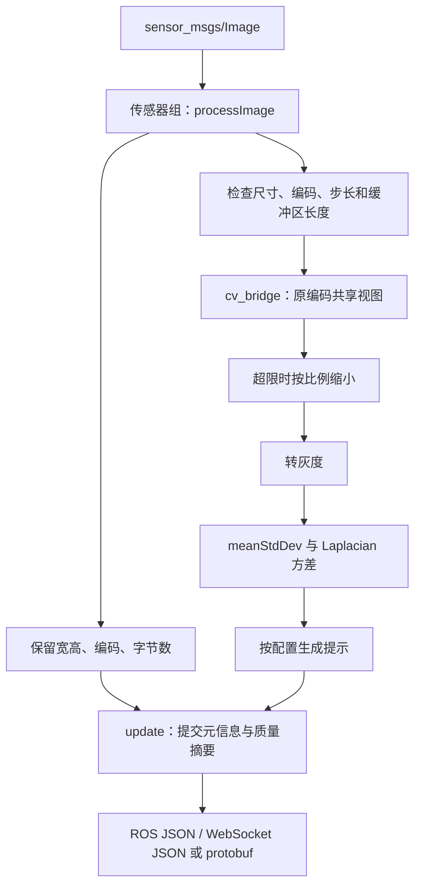

# OpenCV 图像质量诊断

业务目标是区分“近期收到图像”和“图像内容是否值得进一步检查”。
网关保留原始元信息，额外输出亮度、对比度、细节强度及可调阈值提示。
分析默认关闭，通过 image_quality_enabled=true 显式开启。

## 启动与观察

各终端先加载 ROS、工作区环境，并保持相同的 RMW 配置：

```bash
source /opt/ros/jazzy/setup.bash
source install/setup.bash
export RMW_IMPLEMENTATION=rmw_cyclonedds_cpp
```

启动模拟演示并开启图像分析：

```bash
ros2 launch ros_gateserver mvp.launch.py image_quality_enabled:=true
```

另一个终端读取状态，查看 sensors.image.data.quality：

```bash
ros2 topic echo /gateway/status --field data --once
```

真实相机使用 mock=false，并把 image_topic 指向已有的原始 Image Topic。
当前支持 mono8、rgb8、bgr8、rgba8、bgra8，彩色图转灰度时忽略 alpha。
mono16、深度图、Bayer、CompressedImage 和通用 8UC1 等其他输入不会被静默解释为灰度图。

## 真实数据流与代码入口



| 文件与函数 | 职责 |
| --- | --- |
| image_quality.hpp / ImageQualityConfig | 启动配置和分析器接口 |
| image_quality.cpp / declareImageQualityConfig | 声明只读参数 |
| ImageQualityAnalyzer::analyze | 验证输入、获得图像视图、处理错误 |
| boundedGrayscale | 缩放到限制尺寸后转换灰度 |
| measure | 计算指标并按阈值生成提示 |
| gateway.cpp / processImage | 组织元信息，调用分析器，再更新缓存 |
| status_codec.cpp / fillImageQuality | 转换到类型化 protobuf |
| Python codec.py / image_data | 解码并保留有效零值与缺失值的区别 |

实现文件：[分析器](../src/ros_gateserver/src/image_quality.cpp)、
[接口](../src/ros_gateserver/include/ros_gateserver/image_quality.hpp)、
[网关](../src/ros_gateserver/src/gateway.cpp)。

## 指标与结果语义

quality 包含 status、reason、analysis_width、analysis_height、三个数值指标和 flags。
原始 width / height 仍表示相机消息尺寸，不会被缩放后的分析尺寸覆盖。

| 字段 | 定义 |
| --- | --- |
| mean_brightness | 分析灰度图的平均像素值，范围 0～255 |
| contrast_stddev | 分析灰度图像素的总体标准差 |
| laplacian_variance | 分析灰度图拉普拉斯响应的总体方差 |
| flags | too_dark、too_bright、low_contrast、low_sharpness 中满足条件的项目 |

meanStdDev 计算亮度和对比度；Laplacian 使用 CV_64F、ksize=1、BORDER_REFLECT_101，
再对梯度标准差平方得到方差。带符号浮点类型保留正负边缘，不将负梯度截断为零。
默认没有额外高斯平滑。操作原理参考
[OpenCV 梯度说明](https://docs.opencv.org/4.x/d5/d0f/tutorial_py_gradients.html)。

| status | 语义 |
| --- | --- |
| disabled | 默认关闭，没有执行像素分析 |
| ok | 指标计算完成；仍可能包含质量提示 |
| invalid_image | 零尺寸、步长错误、缓冲区长度错误或 cv_bridge 拒绝输入 |
| unsupported_encoding | 当前分析器不支持该编码 |
| size_limit | 原始像素数超过配置上限，未进入 OpenCV 分析 |
| processing_error | OpenCV 运算异常，reason 提供原因 |

未计算指标时数值为 null、分析尺寸为 0、flags 为空；有效的 0.0 则保留为数值。
status=ok 只表示分析完成，不表示没有提示。
阈值采用严格比较：亮度小于 dark 或大于 bright 才提示；标准差和梯度方差小于对应阈值才提示。

低纹理墙面即使对焦正常也可能有低细节指标，噪声则可能抬高梯度方差。
这些提示不能单独证明失焦、遮挡或相机硬件故障。
缩放、分辨率、曝光和场景都会影响指标，实际部署应在固定分析尺寸下标定阈值。

## 参数与资源边界

以下参数在 mvp.launch.py、replay.launch.py 和节点 --ros-args -p 中均可设置。
它们在启动时声明为只读，运行中不会隐式改变分析配置。

| 参数 | 默认值 | 约束 |
| --- | --- | --- |
| image_quality_enabled | false | 布尔值 |
| image_quality_max_side | 320 | 分析图最长边上限，32～1024 |
| image_quality_max_pixels | 8294400 | 原始像素数上限，1～67108864 |
| image_dark_threshold | 30.0 | 0～255，且小于 bright |
| image_bright_threshold | 225.0 | 不超过 255，且大于 dark |
| image_contrast_threshold | 10.0 | 0～255 |
| image_sharpness_threshold | 50.0 | 有限且不小于 0 |

尺寸为零先判为 invalid_image，再检查原始像素预算和编码，最后检查步长与缓冲区。
宽高、行字节数和总缓冲区字节数采用 64 位算术验证，允许行尾 padding。
缩放保持比例、不放大图像，极窄图像的分析边至少为 1。

尽可能共享 ROS 原编码像素，owner 保证分析期间消息有效；不原地修改像素，
临时 cv::Mat 不跨回调保留，缓存和网络只保存统计摘要，不保存或发送图像像素。
这仅是回调内共享视图，不代表 DDS 或整条链路零拷贝。

分析继续运行在 sensor_group_，三路传感器仍然串行；计算在 state_mutex_ 锁外完成。
OpenCV 可能使用内部工作线程，未全局修改其线程设置。
尺寸上限限制后续分析规模，不限制已经到达 DDS 的消息大小，也不构成硬实时耗时保证。

转发关闭时分析和接收继续运行，只隐藏 data；重新开启后可查看最近质量摘要。
fresh 仍表示本机消息新鲜度；自检 Action 当前不读取 quality，不会因提示自动停止设备。

## 录制回放和验证

录制仍只在用户手动启动时进行。分析不是录制器，录包保存的仍是原始 Image 像素。
现有包可以直接回放并重新计算质量：

```bash
ros2 launch ros_gateserver replay.launch.py \
    bag_path:=bags/demo image_quality_enabled:=true use_sim_time:=true
```

quality 为 ImageData 的附加 protobuf 消息，schema_version 保持 1；
新客户端仍可读取缺少 quality 的旧载荷，不会把缺失指标当成有效零值。

[image_quality_test.py](../tests/image_quality_test.py) 默认使用 Domain 138，
隔离回放为 139，阈值标定测试为 140。测试覆盖已知黑白及棋盘像素的精确指标、
五种编码、padding、单像素、缩放、损坏帧、超限元数据、恢复、只读参数、阈值边界、
转发开关、旧载荷、非有限数拒绝，以及原始 MCAP 像素与回放统计的对应关系。

```bash
python3 tests/image_quality_test.py
```

已安装依赖环境中的编译和运行使用 OpenCV 4.6 与 cv_bridge；
当前机器 rosdep 缓存尚未初始化，未执行全新环境的依赖自动安装验证。
