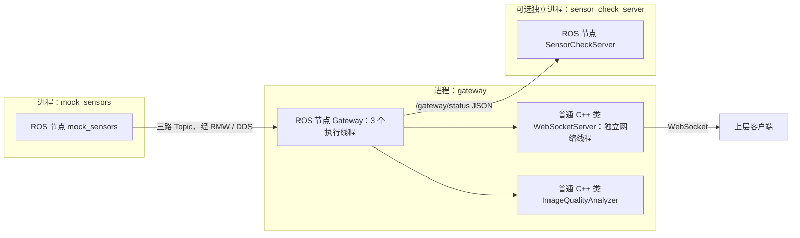
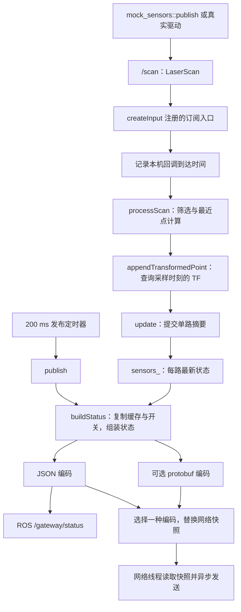

# 项目理解导读：从一条消息到一次面试深挖

本文按数据路径、并发与故障处理介绍当前实现。
不要求第一遍理解所有文件，也不把技术名词数量当作掌握程度。

## 一、先用自己的话说清楚业务

项目接收机器人图像、雷达和里程计，将各路最新状态整理成统一摘要，供上层程序观察。
同时提供转发开关、自检任务和手动录制回放，方便验证通信、定位异常及离线复现。

具体交付物是：能运行的 ROS 节点、网络状态协议、演示客户端、录制回放入口及集成测试。
目前使用模拟源验证，未完成真实硬件负载和 Humble 兼容性验证。

| 上层需要知道什么 | 代码如何提供 |
| --- | --- |
| 传感器最近是否有数据 | received、fresh、age_sec |
| 最近一次采样大致是什么 | 图像元信息、雷达最近点、里程计位姿和速度 |
| 为什么收不到消息 | 端点、类型、QoS 兼容性及事件诊断 |
| 雷达点相对车体在哪里 | 保留采样时间戳并用 tf2 转换 |
| 图像内容是否需要检查 | 可选 OpenCV 亮度、对比度和细节指标 |
| 一段时间内是否持续正常 | 独立自检 Action |
| 如何重现一段输入 | 手动保存原始 ROS 消息，再独立回放 |

当前网络输出包括 WebSocket 和可选的 gRPC 状态流。定位、导航、运动控制和多传感器融合超出网关范围。
讲项目时，先说这个具体用途，再解释技术如何支持用途。

## 二、画清进程、节点、线程和普通对象



默认启动 mock_sensors 和 gateway。self_check=true 增加自检进程，
demo_tf=true 增加静态 TF 发布进程。demo_motion=true 则在已有模拟进程内增加 TF 广播。

必须区分四个概念：

- 进程：独立运行的程序，有自己的内存空间。
- ROS 节点：持有发布者、订阅、服务和定时器等 ROS 接口的逻辑单位。
- 线程：执行代码的线程，执行器和网络库使用它们处理就绪任务。
- 普通对象：分析器、协议转换函数和网络服务器不会因为有一个 C++ 类就成为 ROS 节点。

三路传感器也不是三个订阅线程；它们是 Gateway 中的三个订阅接口。
模拟节点与网关不共享 sensors_，消息通过 ROS 通信到达后，网关更新自己的缓存。
DDS 和 OpenCV 可能有内部线程，因此不能说整个网关进程总共只有四个线程。

## 三、理解启动过程与运行过程的区别

先看 [mvp.launch.py](../src/ros_gateserver/launch/mvp.launch.py)，再看
[gateway.cpp](../src/ros_gateserver/src/gateway.cpp) 中的 main 和构造函数。

```text
Launch 选择要启动的进程，并传入参数
    → gateway 的 main 调用 rclcpp::init
    → 构造 Gateway
        → 声明和检查参数
        → 创建图像分析器、TF Buffer 和 Listener
        → 注册时钟变化处理，创建回调组和缓存
        → 注册发布者、订阅、服务与可选重试定时器
        → 启动可选的 gRPC 服务
        → 直接 publish 一次初始状态
        → 注册周期发布定时器
        → 启动 WebSocket 网络线程
    → 将 Gateway 加入 3 线程 MultiThreadedExecutor
    → executor.spin，调度后续就绪回调
```

create_subscription 注册“以后收到消息时执行谁”，不会立即生成传感器数据。
create_wall_timer 注册周期任务；常规回调需要执行器调度。
构造函数中的首次 publish 是普通函数调用，所以在 spin 之前也可以执行。
它让新连接即使尚未收到传感器消息，也能读到完整初始状态，而不是空字符串。

spin 不是按照函数在文件里的排列顺序逐个调用。程序初始化后，
消息到达、定时器到期、服务请求等事件决定哪些回调就绪，执行器再按回调组约束执行。

## 四、先只追一条雷达消息

第一遍先按 tf_wait_timeout_sec=0 的默认路径阅读。



### 1. 输入包含什么

LaserScan 包含 header、angle_min、angle_increment、有效距离范围和 ranges 数组等字段。
header.frame_id 说明数据属于哪个坐标系，header.stamp 说明采样时刻。
模拟源默认每 100 ms 发布一次三路消息；真实源通过 Topic 参数接入。

### 2. 订阅入口做什么

createSensorSubscriptions 为三路输入分别调用 createInput。
createInput 选择 Topic 和 QoS，注册事件，并把输入分配给 sensor_group_。
入口先记录本机回调到达时间，用于 receive_hz，然后调用 processScan。

receive_hz 是订阅回调到达的估计，received 则在摘要成功提交时增长。
有 TF 等待、时钟未初始化或时间线改变时，两者不能简单互相推导，更不是网络包计数。

### 3. processScan 实际算什么

遍历 ranges，只保留有限且在 range_min～range_max 内的距离。
记录有效数量、最短距离及其下标 i，然后计算：

```text
angle = angle_min + i × angle_increment
x = range × cos(angle)
y = range × sin(angle)
z = 0
```

例如 ranges=[2, 1, 3]、angle_min=0、angle_increment=π/2，
最近点下标为 1，所以雷达坐标下约为 (0, 1, 0)。这是便于手算的例子，
模拟节点实际默认生成 36 个采样。

若 laser_link 位于 base_link 前方 0.2 米且朝向相同，转换后约为 (0.2, 1, 0)。
nearest_m 仍是离雷达原点的 1 米，没有被改成离车体原点的距离。
代码只转换这一个最近点，没有转换整帧扫描，也没有重新选取离车体最近的点。

### 4. update 保存什么

update 补入原始 frame_id 和 stamp，并在 state_mutex_ 保护下更新单路 Sensor：

| 成员 | 保存的内容 |
| --- | --- |
| data | 处理后的摘要 JSON 对象 |
| count | 当前进程内累计提交次数 |
| received | 最近提交的本机 steady_clock 时刻 |
| diagnostics | QoS、端点信息和回调到达记录 |
| epoch | 该摘要属于哪条时钟时间线 |

它覆盖最近摘要，不累积所有扫描，也不长期保存完整 ranges。
未收到数据、采样无有效点、TF 查询失败，是不同情况，不能统一说“雷达没有工作”。

### 5. 为什么收到消息不立即逐条发给 WebSocket

当前业务是最新状态展示。三路输入分别更新缓存，publish 默认每 200 ms 汇总一次。
所以模拟输入 10 Hz、状态发布 5 Hz；WebSocket 的发送完成后还会等待自己的发送间隔。
这三个频率不能当成一个频率。
若需要每条历史消息，就应使用录制或独立事件链路，不能依赖当前覆盖式状态输出。

## 五、看懂发布时的三个数据形态

| 阶段 | 数据形态 | 谁持有 |
| --- | --- | --- |
| 接入 | Image、LaserScan、Odometry 等 ROS 标准消息 | 回调及必要的临时共享所有者 |
| 缓存与组装 | nlohmann::json 对象 | 单路 Sensor、buildStatus 局部变量 |
| 网络发送 | JSON 文本或 protobuf 字节，存入 std::string | snapshot_、每个 Session 的 output_ |
| gRPC 状态流 | 不可变的类型化 GatewayStatus | gRPC 服务和写入中的订阅 |

buildStatus 在同一临界区复制缓存和 enabled_，释放锁后计算新鲜度并组装状态。
publish 由同一份对象产生 ROS JSON，以及被选中的网络编码。
protobuf 转换不解析已经 dump 的 JSON 字符串；ROS Topic 始终保留 JSON。
WebSocket 二进制和 gRPC 复用同一个类型化状态。gRPC 流的配置和生命周期见 [状态协议](protocol.md#grpc-状态流)。

只在单路缓存内保存摘要；序列化时生成临时状态，网络线程读取已编码快照。
网络线程不调用 processScan，也不直接读取可变 sensors_。

## 六、用具体访问解释并发与两把锁

| 执行范围 | 做什么 | 为什么这样安排 |
| --- | --- | --- |
| sensor_group_，互斥 | 三路订阅、QoS 事件、可选 TF 重试 | 输入处理彼此串行 |
| control_group_，互斥 | 开关 Service、周期发布及图检查 | 避免服务与定时发布相互覆盖 |
| 默认互斥组 | TF 接收和使用默认组的内部接口 | 与传感器和控制分别调度 |
| 独立 Asio 网络线程 | 握手、收发、Session 定时器 | 网络事件不在 ROS 回调内等待完成 |
| gRPC 工作线程（启用时） | 等待最新快照并向客户端写入 | 流式写入独立于 ROS 回调和 WebSocket |

3 个执行线程是执行器的工作线程数量，回调组不绑定固定线程。
不同组允许并行，不表示每次都确实重叠执行；同一互斥组的回调不会重叠。

state_mutex_ 解决的是传感器组和控制组之间的共享状态访问，
snapshot_mutex_ 解决的是 ROS 线程与网络线程之间的载荷访问。
互斥回调组只保证组内约束，所以跨组和网络线程仍需要锁。

```text
传感器：锁外处理输入 → state_mutex_ 内提交摘要 → 解锁
发布：state_mutex_ 内复制缓存和开关 → 解锁 → 组装并编码
      → snapshot_mutex_ 内替换载荷 → 解锁 → 发布 ROS JSON
网络：snapshot_mutex_ 内复制载荷 → 解锁 → 异步发送
```

两把锁不嵌套，也不持锁等待网络发送。
handleSetEnabled 修改 enabled_ 后必须解锁，再调用 publish；
否则 buildStatus 会再次获取同一把非递归锁，引起死锁。

服务和定时发布使用同一个控制互斥组，避免旧的定时发布晚于新的服务发布覆盖快照。
但客户端仍可能接收到已经在途的旧帧，所以要检查每帧 enabled，而不是只看服务返回时间。

## 七、把控制路径与数据路径分开理解

### 转发 Service

```text
SetBool 请求 → handleSetEnabled → 改开关 → 立即 publish → 返回响应
```

enabled=false 时隐藏 data，订阅、处理、计数及诊断继续运行。
它不是停止相机或雷达，也不是机器人急停，重新开启后显示最近缓存。

### 自检 Action

```text
Goal → 校验参数与繁忙状态 → 等待接受后的新摘要
     → 记录基线并观察 → 定期反馈 → 生成唯一终态和报告
```

自检是独立节点，通过 /gateway/status 读取摘要，不直接访问 Gateway 的缓存或互斥锁。
目标观察时长范围 1～60 秒，一次只接受一个任务。
默认互斥组串行处理订阅、Action 和 100 ms 定时器，没有 detached 任务线程。

| 函数 | 要能解释的作用 |
| --- | --- |
| handleGoal | 参数检查、忙时拒绝、预留任务名额 |
| handleAccepted | 保存 GoalHandle，建立任务上下文 |
| onStatus / parseStatus | 解析有效摘要，用本机时间记录心跳 |
| startObservation | 从新摘要建立计数基线和 epoch |
| tick | 处理取消、异常、观察结束及反馈 |
| finish | 清除活动任务，发送唯一终态和报告 |

完成检查返回 SUCCEEDED，是否通过看 passed；失联或时间线改变等执行异常返回 ABORTED。
接受取消后，tick 确认 is_canceling 再调用 canceled，因此接受取消不等于已经停止。
当前自检检查计数、新鲜度和可选 TF，不读取图像 quality，也不持久化任务。

## 八、最后再接四个扩展模块

### QoS 诊断：从哪里知道不兼容

createInput 注册 RMW 不兼容事件，inspectPublishers 最多每秒检查一次图端点和实际 QoS。
使用 get_actual_qos，避免把 system_default 当成未解析配置。
事件累计数表示历史；当前图中的兼容端点数量表示当前观察，二者不能混为一个故障标志。
图可见、QoS 兼容、应用已经消费消息，是三个需要分别验证的层次。

### 图像质量：有图像不等于画面可用

processImage 保留元信息，调用 ImageQualityAnalyzer。分析默认关闭；开启后先检查输入，
用 cv_bridge 尽可能共享原像素，限制尺寸后转灰度，计算亮度、标准差及 Laplacian 方差。
只缓存统计值，不缓存 cv::Mat；不原地修改 ROS 像素，也不将像素传给 WebSocket。
quality.status=ok 只代表计算成功，flags 才是阈值提示；低纹理不是失焦的充分证据。

### TF 等待：不阻塞地等什么

默认 TF 查询零等待，失败保留原始点。tf_wait_timeout_sec>0 时，
最多保存 32 份扫描摘要与点，由传感器组的 20 ms wall timer 按 FIFO 重试。
原消息时间戳不变，不换成最新 TF。真实时间超时标记 timeout，队列满标记 queue_overflow。
该队列用于等变换，不是图像与雷达时间同步队列。

### 时间与录放：文件保存在哪个阶段

record_bag 脚本手动启动 rosbag2，保存原始传感器消息和可选 TF，而不是保存网络摘要。
replay.launch 关闭模拟源，从文件重新发布消息，让它们再次经过相同网关处理链路。
开启 use_sim_time 时，入口同时配置播放器 /clock 与节点时间；loop 要求模拟时间。

| 时间或标识 | 用途 |
| --- | --- |
| header.stamp | 原始采集时刻，用于历史 TF 查询 |
| ROS now / stamp_ns | 状态时间，默认系统时间，可随 /clock 暂停或回跳 |
| steady_clock | 新鲜度、频率估计、等待上限、自检观察与心跳 |
| sequence | 进程内发布序号，区分相同 ROS 时间戳的不同帧 |
| clock.epoch | 时间源切换或回跳时增长，使旧缓存与待处理数据失效 |

暂停回放不暂停真实时间的新鲜度与自检窗口。时间回跳由 tf2 清理 TF，
网关原子 epoch 隔离旧摘要；自检观察跨时间线则中止。
sequence 和 epoch 均不是跨进程持久化标识，不代表已实现断线补发或请求去重。

## 九、看清网络异步与对象生命周期

WebSocketServer 在自己的 io_context 线程接入连接，每个连接创建一个 Session。
start 握手成功后启动两条链：read 持续处理连接事件，write 读取快照并发送。
当前 read 丢弃应用消息，所以没有网络控制命令协议。

write 同时只发起一次异步写，完成后等待间隔，再取最新快照。
完成回调再次安排后续任务，不是同步函数不停调用自身导致栈递归。
慢客户端不会让应用给它追加无限历史队列，但 TCP 缓冲区中的旧数据仍可能造成滞后。

| 对象或资源 | 所有者与生命周期 |
| --- | --- |
| ROS 接口与回调组 | Gateway 成员，覆盖执行器运行期间 |
| 传感器原始消息 | 回调的 ConstSharedPtr；图像视图通过 owner 保证分析期间有效 |
| 分析器和 TF 对象 | Gateway 持有 unique_ptr；Listener 早于其引用的 Buffer 释放 |
| Session | 异步回调捕获 shared_from_this，操作期间保持有效 |
| 正在发送的字节 | Session::output_，保持到异步写完成 |
| 网络服务器 | Gateway 最后声明的成员，先析构并停止、等待网络线程 |

main 中执行器结束后才销毁 Gateway。网络线程先于快照和互斥锁释放，
避免网络回调继续使用已经析构的 Gateway 成员。

## 十、按阅读任务打开文件

| 顺序 | 文件 | 本轮只回答什么 |
| --- | --- | --- |
| 1 | [mvp.launch.py](../src/ros_gateserver/launch/mvp.launch.py) | 开了哪些进程，默认和可选是什么 |
| 2 | [mock_sensors.cpp](../src/ros_gateserver/src/mock_sensors.cpp) | 谁生成原始消息，频率和字段是什么 |
| 3 | [gateway.cpp](../src/ros_gateserver/src/gateway.cpp) | 先追 processScan → update → buildStatus → publish |
| 4 | [websocket_server.hpp](../src/ros_gateserver/include/ros_gateserver/websocket_server.hpp) | 谁发送快照，发送期间数据如何保持有效 |
| 5 | [sensor_check_server.cpp](../src/ros_gateserver/src/sensor_check_server.cpp) | 谁读取摘要，如何推进任务和取消 |
| 6 | [image_quality.cpp](../src/ros_gateserver/src/image_quality.cpp) | 如何校验并计算指标，如何限制资源 |
| 7 | [status_codec.cpp](../src/ros_gateserver/src/status_codec.cpp) | 同一状态对象如何变成类型化 protobuf |
| 8 | [replay.launch.py](../src/ros_gateserver/launch/replay.launch.py) | 文件如何重新变成 Topic，谁提供时钟 |

接口包 ros_gateserver_interfaces 只负责生成 Action 类型，不是运行中的任务节点。
声明接口看 CheckSensors.action；业务执行看 sensor_check_server.cpp。

## 十一、用小实验验证理解

每个终端先加载相同环境：

```bash
source /opt/ros/jazzy/setup.bash
source install/setup.bash
export RMW_IMPLEMENTATION=rmw_cyclonedds_cpp
```

第一轮只启动模拟输入、网关与静态 TF，先不开 Action、protobuf、图像质量和模拟时间：

```bash
ros2 launch ros_gateserver mvp.launch.py demo_tf:=true
```

另一个终端查看输出：

```bash
ros2 topic echo /gateway/status --field data --once
```

| 实验 | 先预测，再动手 | 应能解释的结果 |
| --- | --- | --- |
| 基础状态 | 找到一条 scan 的 stamp、frame_id、两个点 | 原始点与目标点不同，数据年龄与采集时间不同 |
| 转发开关 | 调用 SetBool false，再观察计数 | data 隐藏，但接收和计数继续 |
| 输入停止 | 改为 mock=false 启动网关，单独启动并停止 mock_sensors | 状态发布继续；超过阈值后旧数据仍在但 fresh=false |
| QoS 不匹配 | 重启时设置 scan_reliability=reliable | 模拟扫描 BestEffort，图可见但输入不匹配；其他路仍可更新 |
| 图像分析 | 重启时设置 image_quality_enabled=true | 元信息不变，新增计算结果；ok 不代表 flags 为空 |
| 录放 | 停止实时源后，用保存的消息回放 | 输入来自文件，仍进入相同 process / update 路径 |

转发开关的实际命令：

```bash
ros2 service call /gateway/set_enabled std_srvs/srv/SetBool '{data: false}'
ros2 service call /gateway/set_enabled std_srvs/srv/SetBool '{data: true}'
```

需要改变只读可靠性和图像分析配置时重新启动，不能把参数服务返回成功等同于接口已重建。
详细复现分别见 [QoS](diagnostics.md)、[图像](image_quality.md)、[录放时间](replay_time.md)。

## 十二、让面试回答有证据

每个设计准备五句话：需求、做法、代码入口、代价、验证。

以线程隔离为例：

> 需求是让输入处理、转发控制和 TF 接收获得独立调度机会。
> 我配置多线程执行器，并把回调分组；跨组共享缓存和网络快照分别加锁。
> 关键代码是回调组创建、订阅选项、buildStatus 和两把锁的临界区。
> 代价是需要处理共享状态、生命周期及发布顺序，而且仍没有硬实时保证。
> 我验证了持续输入、频繁切换开关、状态一致性和正常退出，未测量真实设备的性能提升比例。

| 测试 | 能支持的结论 |
| --- | --- |
| smoke_test.py | 输入、状态、Service、客户端连接及正常退出 |
| concurrency_test.py | 配置 100 Hz 输入和发布、60 次开关切换下的一致性 |
| tf_test.py | 静态关系、数值、晚到恢复与静态 TF 录放 |
| action_test.py | 目标拒绝、报告、取消、超时和生命周期 |
| protobuf_test.py | ROS 与二进制解码的逐字段一致性 |
| grpc_test.py | 三路状态一致性、多订阅流、取消、退出和回放 |
| rosbag_test.py | 原始消息落盘、收尾、重复目录保护及回放对应关系 |
| qos_test.py | 实际不兼容、端点混合、过期与恢复 |
| time_tf_test.py | 历史 TF、等待、暂停、回跳及动态循环回放 |
| image_quality_test.py | 可控像素指标、编码、坏帧与录包重新分析 |

通过这些行为测试，不等于证明没有任何数据竞争，也不等于完成性能、长期稳定性或硬件测试。

## 十三、掌握程度自检

第一遍先不看代码，画出 processScan、update、buildStatus、publish、readSnapshot 的关系。
能回答以下问题，再进入扩展模块：

1. 收到扫描后，数据存在哪里？为什么不立即逐条送给网络？
2. 三路最新值在同一份 JSON 里，为什么不能说它们采集同步？
3. enabled=false 后，为什么 received 仍然增长？
4. 为什么有互斥回调组仍需要 state_mutex_？为什么网络线程用另一把锁？
5. 图像像素和完整扫描数组最终有没有进入网络载荷？
6. TF 查不到，原始点、摘要、目标点各会怎样？
7. 客户端取消 Action 的响应，为什么不能直接当作业务已经停止？
8. 回放暂停后，为什么 stamp_ns 不变但 fresh 仍可能变为 false？

对每个答案，至少指向一个函数和一项可观察现象。
如果只能说出库名，还说不出输入、输出、状态和失败路径，就回到对应数据路径再走一遍。
