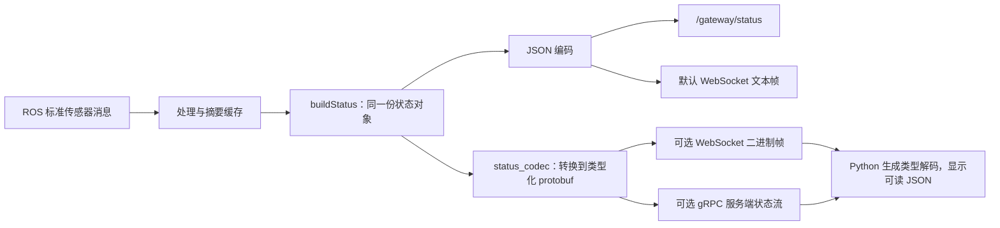

# WebSocket 与 gRPC 状态协议

## 数据流



转换层复用现有状态对象，不解析已序列化的 JSON 字符串。
JSON 和 protobuf 来自同一次 `buildStatus()`，按相同的 sequence 比较。
模拟时间暂停时 stamp_ns 可以重复，旧协议没有 sequence 时才回退到时间戳匹配。
ROS 状态 Topic 始终保留 JSON，自检节点不依赖网络格式。

## 文件与构建

| 文件 | 职责 |
| --- | --- |
| `src/ros_gateserver/proto/gateway_status.proto` | 类型化状态协议 |
| `src/ros_gateserver/src/status_codec.cpp` | 状态对象到 protobuf 的转换与编码 |
| `src/ros_gateserver/include/ros_gateserver/websocket_server.hpp` | 文本或二进制帧发送 |
| `src/ros_gateserver/src/grpc_status_server.cpp` | gRPC 服务端流与快照更新 |
| `src/ros_gateserver/python/ros_gateserver_protocol/codec.py` | 解码并恢复 JSON 字段结构 |
| `src/ros_gateserver/python/ros_gateserver_protocol/client.py` | 演示 WebSocket 客户端 |
| `src/ros_gateserver/scripts/grpc_client.py` | 演示 gRPC 客户端 |
| `tests/protobuf_test.py` | 两路逐字段对比、Action 联动及隔离回放 |
| `tests/grpc_test.py` | 三路状态对比、多客户端生命周期及回放 |

CMake 调用 protoc 生成 C++ 和 Python 类型。C++ 生成文件参与 `gateway_protocol` 库构建，
Python 生成文件安装到 `ros_gateserver_protocol` 包；不手工编辑生成文件。
gRPC 插件生成 C++ 服务与 Python 客户端 stub。依赖由 `package.xml` 声明。

```bash
source /opt/ros/jazzy/setup.bash
colcon build --packages-up-to ros_gateserver
source install/setup.bash
export RMW_IMPLEMENTATION=rmw_cyclonedds_cpp
```

## 发送与接收

启动二进制状态输出：

```bash
ros2 launch ros_gateserver mvp.launch.py demo_tf:=true ws_format:=protobuf
```

另一个加载相同环境的终端读取三帧并显示为 JSON：

```bash
ros2 run ros_gateserver protobuf_client --count 3
```

客户端可配置 `--host`、`--port`、`--timeout`；默认读取一帧。
只使用 Python 标准库处理 WebSocket，protobuf 内容由 protoc 生成类型解析。
客户端校验握手、二进制帧、schema 及消息结构；当前面向本服务的完整单帧消息，
不支持分片消息或 WebSocket 扩展，单帧大小限制为 1 MiB。

默认 `ws_format:=json` 沿用原有文本客户端。格式在网关启动时选择，
同一实例的全部客户端共享该格式，不进行按客户端协商；非法值会使启动失败。
WebSocket 仍然只用于状态输出，没有新增远程控制协议。

回放使用同一入口参数：

```bash
ros2 launch ros_gateserver replay.launch.py \
    bag_path:=bags/tf_demo ws_format:=protobuf
```

录制仍保存原始 ROS 消息及可选静态 / 动态 TF，不保存 protobuf 网络帧。

## gRPC 状态流

`ros_gateserver.protocol.GatewayStatusService/WatchStatus` 接受空的 `WatchStatusRequest`，
返回 `GatewayStatus` 服务端流。建立订阅后先发送当前快照，后续发送更新。
服务只保留最新快照，慢客户端可能跳过中间序号。`sequence` 可用于比较不同传输的同一次发布。
转发关闭时仍推送状态、计数和诊断，三路业务数据为空。

```bash
ros2 launch ros_gateserver mvp.launch.py grpc_enabled:=true
ros2 run ros_gateserver grpc_client --target 127.0.0.1:50051 --count 3 --timeout 5
```

`--timeout` 是整个 RPC 的截止时间。`grpc_enabled` 默认关闭，启用后监听 `grpc_host` 和
`grpc_port`，默认 `127.0.0.1:50051`。`grpc_host` 接受 IPv4 或 IPv6 地址，IPv6 客户端目标
写成 `[地址]:端口`。当前端点使用明文且无认证。

gRPC 写操作由 gRPC 工作线程执行，写入时不持有快照锁。网关退出时唤醒等待中的订阅，
并为尚未结束的 RPC 设置关闭期限。该接口用于状态订阅，ROS Service 和 Action 提供控制与自检。

## 字段与缺失语义

顶层包含版本、转发开关、int64 纳秒时间戳、进程内发布序号、时钟状态及三路 SensorStatus。
SensorStatus 含接收计数、新鲜度、可选年龄和表示具体传感器摘要的 oneof。
新增 diagnostics 独立于 data，即使关闭转发仍可检查 QoS、端点和接收状态。
clock 包含 source、initialized、epoch；sequence 和 epoch 不跨进程重启持久化。
这些为 schema_version=1 的可选、附加字段，旧解码器可忽略；新解码器仍能读取旧载荷。
ImageData、ScanData、OdometryData 均为类型化字段，协议不以 JSON 字符串作为业务载荷。
ImageData 新增可选 quality 消息，保留分析状态、尺寸、三个可选数值和提示列表。
disabled 或异常时指标缺失，对应 JSON null；有效的 0.0 通过 optional 保留。
新解码器仍可读取没有 quality 的旧载荷，细节见 [图像质量说明](image_quality.md)。

| 状态 | protobuf 表示 | Python 客户端展示 |
| --- | --- | --- |
| 未收到消息 | 缺少 age_sec 和 data | `null` |
| 转发关闭 | 缺少 data，保留计数等状态 | `data=null` |
| 有效的零值 | optional 数值字段已设置为 0 | `0` 或 `0.0` |
| 无有效雷达距离 | 缺少 nearest_m 和点 | `null` |
| 原始非有限浮点数 | 不设置相应 optional 数值 | `null`，与原 JSON 一致 |
| 非有限数直接出现在不受信任的 protobuf 输入 | 客户端拒绝 | 明确报错 |

纳秒时间戳使用 int64，Python 解码保持整数精度；演示客户端不经过 JavaScript Number 转换。
标量缺失由 optional 保留，消息存在性和 oneof 保留 payload 是否可用的语义。
相同 schema_version 下添加未知字段不影响当前字段读取；不支持的版本和错误的传感器
payload 类型会被客户端拒绝。后续扩展不能复用已有字段编号。

## 并发和验证范围

JSON 与 protobuf 序列化都在状态缓存锁外执行，随后只在网络快照锁内替换载荷。
二进制载荷存入 std::string，发送使用缓冲区长度，允许包含零字节。
网络线程不访问可变传感器缓存，也不在持锁时等待发送。

测试按相同 sequence 逐字段比较 ROS JSON 与解码结果，检查空数据、零值、NaN、
TF、开关、客户端命令、未知字段、不支持的版本、错误 payload 类型和独立 Domain 回放。
这验证语义一致性，不构成编码速度、带宽节省比例或端到端延迟的性能基准。
QoS 与回放时间语义见 [诊断说明](diagnostics.md) 和 [时间说明](replay_time.md)。

optional 字段语义参考 [protobuf 官方字段存在性说明](https://protobuf.dev/programming-guides/field_presence/)。
