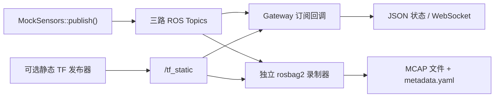
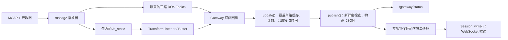

# 演示录制与回放：代码和数据流

录制入口由用户显式运行，默认录制 10 秒。录制和回放各有独立入口，
现有网关通过相同的 Topic 接收实时数据或录包数据。

## 文件结构

```text
src/ros_gateserver/
├── scripts/record_bag.py       # 录制命令、计时、信号处理、文件收尾检查
├── launch/mvp.launch.py       # 实时演示：模拟节点、网关、可选静态 TF
├── launch/replay.launch.py    # 回放：复用网关入口并启动 rosbag2 播放器
├── config/rosbag_qos.yaml     # /tf_static 晚加入接收所需的 QoS
├── src/mock_sensors.cpp      # 生成三路原始 ROS 消息
├── src/gateway.cpp           # 订阅、缓存、构造 JSON
└── include/ros_gateserver/websocket_server.hpp
tests/rosbag_test.py           # 录制、读取 MCAP、回放并比对输出
tests/tf_test.py               # 静态 TF、隔离回放和坐标数值验证
bags/                         # 默认演示录包位置，已忽略 Git 跟踪
```

CMake 将 `record_bag.py` 作为可执行脚本安装，命令名为 `record_bag`，
所以加载安装环境后可运行 `ros2 run ros_gateserver record_bag`。
Launch 和 config 目录安装到包的 share 目录，供启动器和录制命令查找。

## 录制流程



录制器和网关是各自独立的订阅者。MCAP 保存完整原始消息，
包括网关 JSON 中未输出的图像像素和完整雷达数组。

`record_bag.py` 的函数职责：

1. `parse_arguments()` 检查时长和 Topic 名称；默认订阅图像、雷达、里程计。
   `--with-static-tf` 额外录入 `/tf_static`，并指定必须存在的直接坐标关系。
2. `main()` 确定输出目录，拒绝已有路径，通过参数列表启动 `ros2 bag record`。
3. `wait_until_recording()` 等待 MCAP 文件创建，再开始计时；DDS 发现仍可能产生少量延迟。
4. `record_for_duration()` 用单调时钟等待指定时长，同时检测提前退出和用户停止请求。
5. `stop_recorder()` 向录制进程组发送 SIGINT，并等待退出。
6. `report_recording()` 读取最终元数据，确认每个指定 Topic 都有消息。
   开启 TF 检查后调用 `check_transform()`，反序列化录入的 TFMessage，
   确认包含指定的父子坐标关系，随后才显示录制成功和计数。

进程组隔离使 Ctrl+C 仅结束本次录制和它管理的子进程。信号处理函数只设置停止标记，
实际收尾由正常控制流完成。停止信号让 rosbag2 关闭 MCAP、写出 `metadata.yaml`；
超时后才尝试强制退出，并明确报告文件可能不完整。

MCAP 文件创建前最多等待 15 秒。默认的 10 秒从文件创建后开始计时，
实际记录消息的覆盖时长还受 Topic 发现和调度影响。任一路没有录到消息都会报告失败；
可能已经产生的诊断文件保留在输出目录中，便于查看原因。

## 回放流程



`replay.launch.py` 的 `generate_launch_description()` 声明参数。
`OpaqueFunction` 在启动时调用 `launch_replay()`，此时才解析参数值、验证目录和播放速度。
该函数复用 `mvp.launch.py`，传入 `mock=false` 和 `demo_tf=false`，
根据元数据将存在的 `/tf_static` 和 `/tf` 加入播放列表，再通过 ExecuteProcess 启动播放器。
默认给播放器留出 2 秒启动延迟，也可以调整 `start_delay`。

`report_playback_exit()` 处理播放器退出：正常结束后保留网关观察过期状态，
异常退出时输出原因并请求 Launch 关闭相关进程。手动演示最终由用户 Ctrl+C 结束。
回放入口播放三路指定 Topic 和包内静态 TF，使用新录包的相同 Topic 名称即可接回现有网关。
没有静态 TF 的旧包仍可回放，但会输出提示；缺少外部 TF 时，雷达摘要保留、目标点不可用。

## ROS 2 在底层做了什么

1. **发现通信端点。** 本项目的 rclcpp 通过 RMW 接入 DDS；不同进程在相同 ROS Domain
   中发现发布者和订阅者，按 Topic 名称、消息类型及兼容 QoS 建立数据通路。
   录制、实时演示和回放终端应加载同一 ROS 环境和 RMW 设置。
2. **保存序列化数据。** 本机使用 DDS 的 CDR 序列化。rosbag2 录制器接收序列化消息，
   写入 MCAP，并保存消息类型、Topic、接收时间和发布端 QoS 等信息。
   录包数据不经过网关的 JSON 转换层。
3. **重新发布消息。** 播放器读取录包，按记录的时间间隔和播放倍速安排发布，
   将保存的消息重新送到同名 Topic。网关的类型化订阅回调随后获得 Image、LaserScan、
   Odometry 对象，执行和实时输入相同的字段提取逻辑。
4. **区分两种时间。** 消息 `header.stamp` 是原始传感器时间，回放保留该值。
   网关顶层 stamp_ns 来自节点 ROS 时钟，默认跟随系统时间，age_sec 使用单调时钟计算接收间隔。
   默认不启用模拟时间；use_sim_time=true 时入口同时配置节点时钟并让播放器发布 /clock。
   age_sec 仍按实际经过时间计算，播放结束后 wall timer 继续输出，数据自然过期。
5. **遵守 QoS。** 现有传感器发布和网关订阅使用 `SensorDataQoS`，包含 best-effort 策略。
   rosbag2 根据发布者信息选择录制 QoS，并在回放时使用保存的 QoS 信息。
   启动延迟有助于发现端点，best-effort 仍允许丢包，因此测试按内容和原始时间戳验证，
   不要求网关收到的消息数与录包逐条相等。
6. **保存固定安装关系。** 静态 TF 发布器可能先于录制器启动，不能依赖后续周期消息。
   `rosbag_qos.yaml` 为 `/tf_static` 指定 reliable 和 transient_local，录制器能够
   接收仍在运行的发布器保留的 TF；回放也使用该配置，便于网关晚加入时接收关系。
   transient_local 的保留依赖发布者存活，不是磁盘持久化，真正离线恢复仍须录入 bag。
   固定关系不随扫描时间变化，默认仍可使用系统时间。
   动态关系支持 --with-dynamic-tf 录制和直接关系检查，回放可以选择模拟时间。

动态 TF 的完整演示、循环与时间回跳处理见 [动态 TF 与回放时间](replay_time.md)。

QoS 行为参考 [ROS 2 Jazzy 官方说明](https://docs.ros.org/en/jazzy/How-To-Guides/Overriding-QoS-Policies-For-Recording-And-Playback.html)。

## 测试怎样证明回放有效

`tests/rosbag_test.py` 在独立 Domain 中启动模拟发布者，调用安装后的录制命令，
使用 `SequentialReader` 读取 MCAP，并用 `deserialize_message()` 恢复原始消息对象。
它检查三路消息类型和原始像素，再验证重复目录保护和 Ctrl+C 的文件收尾行为。

随后测试停止模拟发布者，使用新 Launch 回放保存的数据。WebSocket 收到的每路状态
都按 `header.stamp` 查回 MCAP 原始消息，逐项比较图像元数据、雷达最近距离、里程计
位置、姿态和速度。最后检查回放结束后的过期状态与退出流程。
测试使用临时目录和端口，结束后清理录包和进程。

`tests/tf_test.py` 进一步检查平移和 90 度旋转的实际坐标，以及 `target_frame` 的参数传递。
先验证无 TF 时原始点仍可用，再启动 TF 发布器，确认后续扫描恢复。
录制场景在静态 TF 已经发布后才启动录制器；读回 MCAP 检查安装关系和旋转四元数。
随后关闭全部实时进程，并在另一 ROS Domain 回放，根据包内扫描数据独立计算期望点，
比对 ROS 与 WebSocket 输出，避免测试借用现场 TF 或使用不同帧的数值比较。
旧包、缺失静态 TF、存在无关 TF，以及非有限安装参数均有对应检查。
